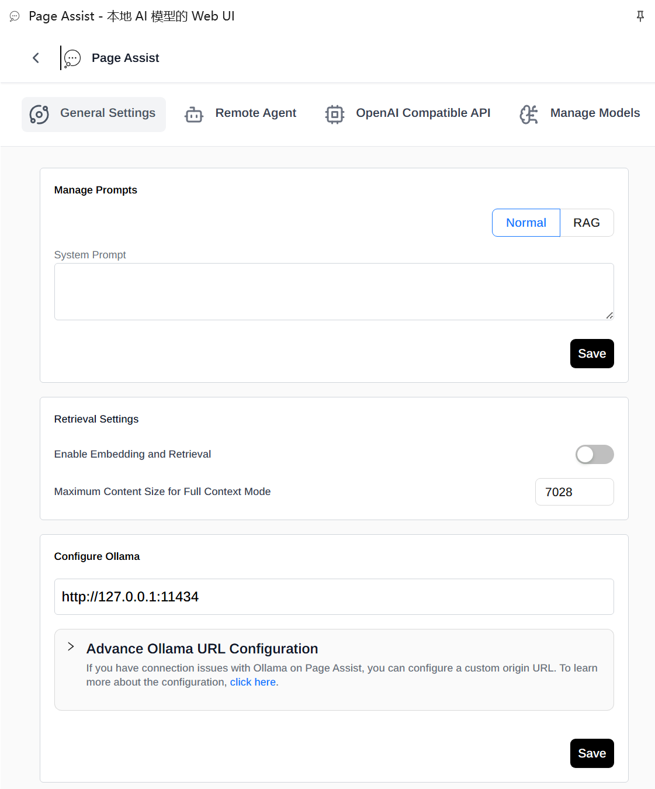

# Page Assist channel (0.1.1)

仓库：[refeved/qwenpaw-channel-page-assist](https://github.com/refeved/qwenpaw-channel-page-assist)。
插件清单及入口直接位于仓库根目录，
无需克隆或修改 QwenPaw 源码。宿主使用 pip 发布版；插件仍运行在宿主进程内。

独立安装的单 Agent 频道插件。运行在 QwenPaw 进程内，自带一个 HTTP 监听端口；
不修改核心、不单独部署中继服务，也不调用 OpenAI-compatible 聊天接口绕过原生 Agent。
它是 Page Assist **Remote Agent** Provider 的首个后端实现。当前发布组合为
v0.1.1：QwenPaw `2.2.2.post1`、Page Assist `agent-usage-v0.1.1`、本插件
`qwenpaw-channel-page-assist-v0.1.1`（插件版本 `0.1.1`）。界面 Provider 名为
Remote Agent；协议、存储键、路由和前端客户端仍沿用 `qwenpaw` 命名空间。

## 第一版范围

- 一个频道地址绑定当前工作区的一个 Agent；不是全局 Agent 网关。侧栏回复显示该
  Agent 配置的名称（0.1.1 起），不再使用固定标签。
- 文字提问、同聊天追问、新建独立聊天。
- 显式分享网页正文或选区，复用 Page Assist 的快照预览与确认。
- 通过 `BaseChannel.consume_one`、原生 TaskTracker 和工作区执行函数运行 Agent。
  原生工具、记忆与权限策略不被替换。
- 显示已完成的文本消息，不显示隐藏思考或工具参数。SSE 仅运输完整消息和状态，
  不实现逐 token 输出。
- 原生审批在侧栏内联处理：直接复用 ApprovalService 的待审批记录与原生决定入口
  （`exact` 始终可选，`similar` 仅在原生给出泛化目标时提供），不自动批准、
  不降级权限、不绕过检查。归属无法确认或超出本版本的审批仍在 Console 处理。
- Remote Agent 界面只保留文字聊天、显式网页／选区分享、当前实例内会话历史和
  新建会话。本地 RAG、联网搜索、MCP、提示词、临时聊天、逐会话模型参数、
  文件／图片上传、视觉／OCR、语音、Page Action 和 WebMCP 不提供或禁用；
  未接通入口会说明原因。
- Firefox 版本不显示 Remote Agent 入口（MV2 缺少
  `chrome.storage.local.setAccessLevel`）；请使用 Chrome／Chromium。

延期：全局多 Agent 发现、跨重启历史恢复、断线自动恢复、持久请求账本、
取消按钮、富媒体、主动推送、审批事件推送。不要依赖本版本作为生产远程网关。

## 安装与连接

在**已有完整 QwenPaw 运行环境**的终端安装本仓库根目录：

```bash
qwenpaw plugin install /path/to/qwenpaw-channel-page-assist
```

宿主尚未安装时先执行 `pip install qwenpaw==2.2.2.post1`。
更新插件代码后执行 `qwenpaw plugin install /path/to/qwenpaw-channel-page-assist --force`，
再重启宿主；安装目录是宿主管理的副本，不会随仓库编辑自动更新。
不需要构建 QwenPaw Console，也不需要设置 `PYTHONPATH`。

两条安装前提（实测于 QwenPaw 2.2.2.post1）：

- 宿主用自身 Python 环境的 pip 安装 `requirements.txt`，该 pip 不得低于 `26.2.2`，
  否则安装会在依赖步骤被判为不安全并整体回滚。
- 安装源目录不要携带 `.git`：宿主整目录复制，Windows 下只读的 git object 会导致
  复制阶段失败。可先把 `plugin.json`、`plugin.py`、`channel.py`、`protocol.py`、
  `requirements.txt` 复制到空目录再安装。

在 Console 中确认插件启用，选中目标 Agent，在频道管理中配置 **Page Assist**：

| 配置 | 值 |
| --- | --- |
| Enabled | 开启 |
| Browser token | 自行生成的随机专用密钥，至少 32 个 ASCII 字符，无空白 |
| HTTP bind address | 本地验证使用 `127.0.0.1` |
| HTTP port | `8766`，不同 Agent 必须使用不同端口 |

可在 QwenPaw 的 Python 环境中用 `python -c "import secrets; print(secrets.token_urlsafe(32))"`
生成随机密钥。不要将密钥写入仓库、日志或聊天。

频道配置只从 **Agent 级** 配置读取，即 `workspaces/<agent>/agent.json` 中的
`channels.page_assist`；写在宿主全局 `config.json` 的同名键不会启动监听。用 Console
或频道管理界面保存即可，不需要手工改全局 Agent 路由。

首次安装或修改频道配置后重启 QwenPaw，检查日志出现
`Page Assist channel listening on 127.0.0.1:8766`。
本版本不依赖“先启动新监听、再关闭旧监听”的热替换流程；端口冲突会明确报错。

以下步骤要求使用包含 Remote Agent Provider 的 Page Assist 构建
（发布 tag `agent-usage-v0.1.1` 或 `feat/qwenpaw-remote-channel` 分支）。
重新构建并重新加载扩展后：

1. 在 Chrome 侧边栏 header 左侧、Page Assist 字样之后，把 **Local models** 切换为
   **Remote Agent**。首次使用且没有 provider 记录／Ollama URL 时，空态显示
   “Choose how you want to chat”；选择 Remote Agent 且尚未配置时，连接表单内联展开。
2. 已有配置可通过 header 切换器，或 options／侧栏设置中的独立 **Remote Agent** Tab
   （`/settings/qwenpaw`）打开同一连接表单。该 Tab 与 General Settings、
   OpenAI Compatible API、Manage Models 并列，不在 General Settings 中。
3. 服务地址填写 `http://127.0.0.1:8766`，不是 Console 的端口。
4. 浏览器凭据填写同一个 Browser token，不使用 Console 管理员令牌。
5. Console 地址暂留空。第一版仍保留前端同源链接限制，而 Console 通常在不同端口，
   因此需要手工打开原 Console，不通过聊天内容中的链接授权。
6. 测试连接、保存、返回；首条问题自动创建聊天，顶部新建按钮可开始另一段聊天。



上图是侧栏设置的 Tab 栏；options 页的导航还额外提供 RAG、Ollama、MCP 等条目。

远程路径不需要 Ollama 配置。Firefox 不提供 Remote Agent 入口；界面细节与最新行为
见 Page Assist Fork 的 [Remote Agent 指南](https://github.com/refeved/page-assist-agent-usage/blob/feat/qwenpaw-remote-channel/docs/qwenpaw-remote.md)。

WSL Chrome 与 QwenPaw 在同一 WSL 环境中时可直接使用上述 loopback 地址。
不要直接将明文监听暴露到公网。远程使用必须自行部署 HTTPS 反向代理，
仅代理此专用端口，并继续保留插件 Bearer 认证；扩展拒绝非 loopback HTTP。

**凭据权限**：本版本是一个共享凭据代表一个浏览器用户，可调用绑定 Agent 的
原生能力；不是多用户身份系统，也没有额外的逐工具 token scope。
只给可信浏览器使用；原生工具审批仍按 Agent 自身策略执行。

## 状态与数据边界

浏览器路径保持 `/api/page-assist`。提供 capabilities、唯一 Agent、新建聊天、
提交消息、会话内历史、请求状态及请求事件接口。接口载荷沿用前端 v1，声明
`recovery=false`、`approvals=true`、`approvalEvents=false`；待审批列表与决定走
`GET /approvals` 与 `POST /approvals/{id}/decision`，前端每 5 秒轮询对账，
不依赖推送。

- 同一聊天一次一个请求，占用时返回 409，不进入消息合并队列。
- 同实例内相同 requestId 与相同负载不会重跑；负载或聊天不同时返回 409。
- 同时最多保留 100 个聊天、500 个请求；达到容量返回 429，不静默驱逐。
- 待审批只暴露本频道实例、本浏览器凭据所拥有会话的记录；其他频道或其他实例的
  审批不可见也不可决定。同一 `decisionId` 重复提交返回已确认结果，与已确认结果
  冲突的决定返回 409，不覆盖原生结论。
- 请求、网页负载和浏览器展示历史仅保存在内存。频道重新实例化后 instanceId
  改变，前端缓存自动分区；需要新建聊天，不能恢复旧的浏览器聊天。
- 原生历史、记忆或工具副作用可能已持久保存，**不随频道内存清空而删除**。
- 关闭浏览器或停止显示不取消 Agent。提交结果丢失或运行时断线后，前端不自动
  重发，不承诺恢复；请到 Console 核实，避免重复执行有副作用的请求。
- 关闭频道会停止其原生运行任务。服务停止不保证已经执行的工具副作用可撤销。

## 开发验证

单独克隆本仓库后，在开发虚拟环境中执行：

```bash
python -m pip install -r requirements-dev.txt
python -m pytest -q tests/test_channel.py
```

在集成工作区根目录中，复用现有发布版环境验证：

```bash
env -u PYTHONPATH .venv/bin/python -m pytest -q \
  qwenpaw-channel-page-assist/tests/test_channel.py
cd page-assist
bun run compile
bun run build:chrome
node tests/qwenpaw-channel-browser.mjs
```

测试还需要 `pytest`、`pytest-asyncio` 以及宿主的 AgentScope 等原生依赖。
浏览器测试默认使用工作区 `.venv/bin/python`，可通过 `QWENPAW_TEST_PYTHON`
指定解释器；插件位于其他目录时通过 `QWENPAW_CHANNEL_DIR` 指定仓库根目录。
测试不注入 QwenPaw 源码路径，使用该解释器实际安装的宿主。
使用系统 Chrome / WSLg，并自动清理测试进程和临时浏览器目录。

这组测试使用真实插件 HTTP、BaseChannel 和 TaskTracker，但 Agent 执行函数、
ChatManager 与工具发现配置是隔离的确定性测试替身，**不是模型、记忆和真实
审批服务的端到端验收**。最终仍需在已有 Agent 上手工验证实际模型和工具。

## 许可与免责声明

本仓库采用 [Apache License 2.0](LICENSE)。

本项目是独立的社区插件，与 QwenPaw、Page Assist 项目无隶属关系，也未获其背书。
插件通过 QwenPaw 的公开插件 API 运行，不包含上游源代码。Page Assist 为
Muhammed Nazeem 的 MIT 许可项目，QwenPaw 为 Apache-2.0 项目；
相关名称与图标归各自权利人所有。
